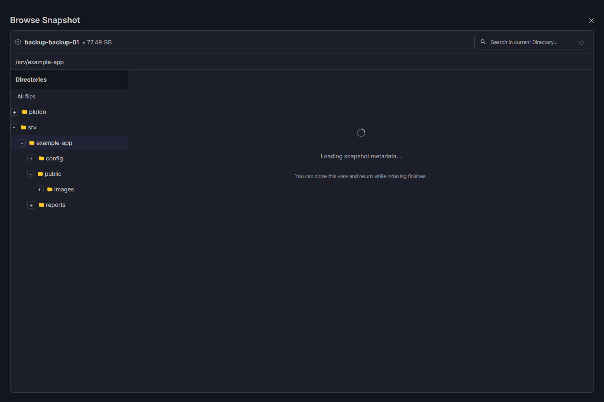
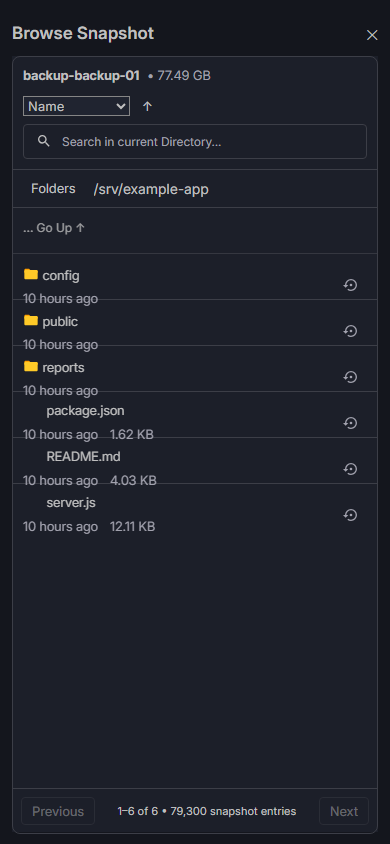
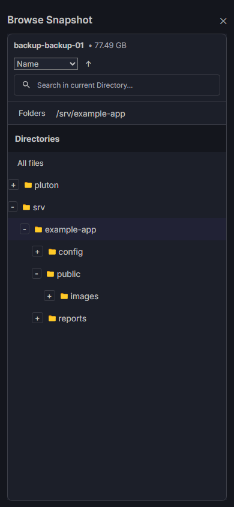

# Classic Managed Snapshot browser and index reliability

Validation date: 2026-10-26. Branch: `codex/classic-browser-index-reliability`.
Base: freshly fetched `origin/main`, `4f3e0200e16372be25dbe2fdb8d1bdc0c7fac84a`,
which retains the standalone MySQL startup repair. One local delivery commit;
its exact SHA is reported with delivery. No push, merge, deployment, server restart,
live storage/database access, repository mutation or standalone Agent change.

## Confirmed regressions and production uncertainty

The unchanged main-branch cache was executed with disposable synthetic metadata.
After A and B completed with no readers, C failed with `index-resource-limit`;
A and B both remained `ready`. Admission compared the map size to two but had no
idle eviction. Therefore idle Browse indexes could also block Generate Download
and recovery preparation. The cause does not depend on logical backup bytes.

`browsePage()` also captured `failure(key)` before `retry(key)` removed that entry,
then threw the saved failure. The service regression test now proves that a failed
attempt remains visible until explicit retry, and that retry/polling observes the
new attempt without the cleared failure. Concurrent requests share one build.

The previous Managed viewer directly rendered breadcrumb buttons instead of the
existing classic directory sidebar. This was a presentation regression independent
of streaming. The restored tree reuses the common directory component, toolbar,
virtual file list, file rows and staging modal. Local/Legacy APIs and navigation
implementations remain in place; their shared sidebar's added props are optional.

The actual production failure has **not** been attributed to disk capacity, quota,
entry count or index bytes. No production snapshot was inspected. The known idle
admission defect is reproduced, not proof that it alone caused a particular live
failure. For a live rejection collect the safe HTTP code/reason and numeric
`snapshot_index` event described in [the operator guide](MANAGED_SNAPSHOT_STREAMING.md#errors-and-safe-diagnosis).
Do not share raw logs, config, credentials, SQL or internal paths/inventory.

## Focused implementation and unchanged boundaries

Admission/expiry/retry/eviction use one serialized, bounded admission path (maximum
16 pending admissions). Completed idle reservations are least-recently-used victims;
equal timestamps resolve in stable insertion order. Idle files can be released for
disk admission even before both slots are filled. Builds and active consumers are
never victims. Lease acquisition is atomic with admission, and no lock is held while
building or consuming a manifest. Cleanup closes SQLite first; cleanup failure
keeps its reservation. Shutdown cancels builds and waits for active consumers.

Limits remain **two reservations, one construction, 256 MiB per index, 500,000
nodes, 15-minute idle TTL and 320 MiB available space before construction**.
There is no queue waiting for a build slot: another build gets a closed busy result.
Expired/failed generated files are removed safely, and restart discards only exact
generated cache-directory names. The application database is never opened for
cache cleanup. No manual cache deletion is required after deployment.

Errors retain their public code and gain a closed reason: `cache-active`,
`build-busy`, `admission-busy` (429); `disk-capacity` or ambiguous `storage-full`
(507); `database-size` or `entry-count` (413); `unavailable`/`cleanup-failed` (503);
`metadata-invalid` (422), `timeout` (504), or `cancelled`. Busy page responses have
Retry-After. SQLite FULL is not automatically evidence of a full disk or a proven
page-cap failure: rollback can reset page counts, and filesystem quotas may be
invisible to statfs. Bounded allocation samples and available-byte observations
support diagnosis without exposing raw exceptions.

The page API adds only validated Boolean `directoriesOnly` and `retry` flags.
Every request retains the authenticated exact backup/repository/plan/snapshot
binding, ownership tags, availability and stored-binding checks. Explicit retry
sends its flag once; failure stops polling instead of repeatedly rebuilding.

The tree loads root and expanded direct-child directories in pages of 200; it
retains at most 4,096 directory nodes, 512 branches/expansion choices and eight
pending requests, plus at most 512 derived selected-ancestor rows. Previous/next
folder controls support more than 500 siblings. A selected path from another file
page stays visible without fetching that sidebar's intermediate sibling pages.
Selected ancestry is retained within the budget; inactive pages can be evicted
and reloaded. If ancestry itself exceeds the budget, loading stops with a clear
collapse/retry message. Collapse/unmount cancels work. The current file page is
separate (200 rows, API maximum 500), server-sorted/searched, with zero inactive
React Query cache retention. Managed metadata never enters IndexedDB/Dexie.

The left tree, selected-folder indication, empty/loading/error states, responsive
file table, Name/Last Modified/Size/Actions, mobile sort/Folders controls and
existing staged Restore selection are preserved. There is no Browse file-download
action. Generate Download still validates the complete manifest before a direct
TAR stream with backpressure and disconnect cleanup. It cannot be blocked solely
by two idle Browse indexes. No HCP mirror fallback is added.

Incremental NDJSON validation, full IDs/tags, unsafe node rejection, SFTP ownership,
TLS, SQL SHA-256 checks, private staging, no overwrite/delete and native MySQL
worker identity/IPC/client checks remain enforced. No application migration,
environment variable, lockfile/dependency, backup schedule, retention, replication,
encryption or Agent 0.7.1 protocol change is introduced.

## UI evidence

Actual components and styles rendered in an isolated browser preview with synthetic
metadata and stubbed network/restore mutation. These are not production screenshots.
Headless Chromium checked tree expansion, selected folder, restore modal and no
horizontal page overflow at 1440×960 and 390×844.

## Validation and resource evidence

Docker fixtures are non-root, read-only, isolated from external networking and
mount only test code. The load container is limited to 2 GiB; generated metadata
runs with a 128 MiB JavaScript heap. They create only disposable repositories/data.
Measurements represent this workstation's Docker Linux environment, not a live VM
or guaranteed production throughput. Logical profiles do not allocate GiB of data.

| Check | Result |
| --- | --- |
| Full backend `pnpm --filter @plutonhq/core-backend test --runInBand --silent --verbose=false` | 199 suites; 4,014 assertions passed, four platform skips; 139.268 seconds; normal runner lingered after completion |
| Full backend with `--detectOpenHandles --openHandlesTimeout=3000` | 199 suites, 4,014 passed, four skips; 158.51 seconds; exit 0, with two existing stream-fixture handle warnings explained below |
| Final cache lifecycle/sort coverage | 16 unique tests, included in the full suite; deterministic name/size/time/search and sanitized filesystem-admission errors |
| `node --experimental-strip-types --test frontend/__tests__/*.test.ts` | 306 passed, including 80-level navigation, 601 siblings, off-page selection, paging, retry, cancellation and staged Restore payloads |
| Backend/frontend TypeScript | Passed (`tsc --noEmit -p tsconfig.json` / `tsc -b`) |
| Backend lint / focused frontend lint | Passed; full frontend command limitation explained below |
| `pnpm build` | Three production tasks passed; bundled frontend/backend and documentation gates |
| Worker image build and package/startup checks | Genuine Oracle 8.4.11 image built; 18 script tests passed; standalone module/config gate retained |
| Disposable Oracle MySQL worker | Three fresh starts and all 12 original scenarios passed, including restart/cancel/TLS/credentials/marker/cleanup |
| Retained Custom Oracle MySQL | 20 passed, including 20 preflight plus 20 import cancellation cycles |
| Internal disposable / retained Oracle MySQL | Seven + seven passed; retained Stop/Resume and ownership cleanup included; resource-refused is an expected refusal, not successful recovery |
| Linux `validate-phase6.ps1 -BackendTests -Image pluton-phase6-tests:local` | 12 suites; 336 passed, one complementary platform skip; 71.946 seconds |
| Native `validate-phase6.ps1 -Modes phase6-mixed` | Passed real MariaDB 11.8.8 + PostgreSQL 18.6 dump/import, exact-snapshot SQL-only staging, hashes, cleanup, stopped source DBs, replay idempotence and unchanged SFTP/Restic repository |
| `validate-managed-snapshots.ps1 -Image pluton-managed-snapshot-validation:local` | All four generated load profiles, small real SFTP recovery and large real SFTP three-snapshot switching passed |
| Headless desktop/mobile | Tree/selection, search/size-sort, staged Restore modal and no horizontal overflow passed |
| `git diff --check` | Passed |

Generated fragmented NDJSON measurements (each manifest has two additional
directory records; sizes below include all six SQLite secondary indexes):

| File profile | Logical bytes | Metadata bytes | Build ms | SQLite bytes | Peak Node RSS bytes | Page p50/p95 ms |
| --- | ---: | ---: | ---: | ---: | ---: | ---: |
| 22 | 18,304,000 | 10,902 | 13 | 61,440 | 104,132,608 | 0.14 / 0.26 |
| 5,000 (3.16 GiB) | 3,393,025,000 | 2,488,890 | 141 | 8,798,208 | 118,378,496 | 3.98 / 5.39 |
| 79,300 (77.49 GiB) | 83,204,256,200 | 39,638,890 | 1,841 | 139,284,480 | 128,630,784 | 27.63 / 32.42 |
| 100,000 | 83,200,000,000 | 49,888,890 | 2,005 | 175,640,576 | 128,589,824 | 36.64 / 47.38 |

The large generated profiles average about 1,756 SQLite bytes per node; sampled
JavaScript heap remained below 20 MB. Real Restic paths in the native fixture cost
about 2,480 bytes per file including ancestor/secondary-index overhead. That
100,000-file index used **248,045,568 bytes (236.55 MiB)**, so the existing 256 MiB
cap is realistic for these measured profiles but not a guarantee for arbitrary
long paths or all 500,000-entry snapshots. The cap was not increased.

Final native SFTP/Restic measurement: 52,360,205 metadata bytes, 15,247 ms initial
indexing, 928 ms authenticated page, 1,593 ms to download readiness and 4,600 ms TAR
transfer. All 100,000 files were parsed from a 102,403,072-byte TAR; whole-TAR
temporary disk was zero. Three further switches B → C → A (including Generate
Download preparation) took 28,932 ms total with at most two generated indexes.
Peak observed completed-cache bytes were **496,091,136**; Node peak RSS was
305,504,256 bytes and container cgroup peak 1,414,500,352 bytes, including the
tmpfs-backed real fixture source/repository/indexes and native subprocesses.
These figures do not represent a production server's complete concurrent load.

The small native fixture verified full/granular/custom staging, matching hashes,
two historical TAR downloads, cancellation, credential cleanup and unchanged
source/repository digests. The large fixture creates three historical tagged
snapshots, proves ownership/full-ID selection and unchanged read-only repository
objects through switching/download, and also runs its separately authorized
fixture backup concurrently with indexing. It uses tiny content, not an actual
77 GiB transfer. Proxy throughput, production quota and concurrent live jobs remain
operator acceptance work.

Reproduction/check commands are in [the runtime guide](MANAGED_SNAPSHOT_STREAMING.md#validation-and-measured-resources).
Native MySQL scripts use `-WorkerImage pluton-classic-worker-validation:local`
and `-RuntimeImage pluton-managed-snapshot-validation:local` for this validation;
all names/data are disposable and no production volumes are mounted.

The full frontend lint command encounters the existing ESLint configuration error
(`typescript-eslint.config` does not support the string `eslint-config-prettier`
in extends), before examining files. The repository config/dependencies were not
changed. Changed frontend sources additionally pass the same existing rules using
a temporary loader copy resolving that string to its config object. No rule or test
assertion was disabled. Existing concurrency tests wait for actual construction
instead of assuming one event-loop turn finishes async filesystem admission.

The normal full test run completed every assertion but its process lingered. A
diagnostic rerun, without force-exit or suppressed checks, exited 0 and identified
two `STREAM_END_OF_STREAM` resources rooted in the unchanged oversized-frame TCP
fixtures in `mysqlPersistentDatabaseImporter.test.ts:280` and
`mysqlRecoveryWorker.test.ts:422`. No index-cache handle was reported. These test
fixtures and their worker/importer implementation were not changed in this task;
the focused cache/service/controller runs exit normally. This test-harness warning
remains visible rather than being presented as completely warning-free validation.

An initial native worker check timed out at the ready-log signal while the worker
was running. A diagnostic-only rerun found fresh ready events on all three starts;
its command wrapper interfered with fixture SQL stdin and was discarded. The
unchanged runner subsequently passed three fresh starts and all 12 scenarios.
No timeout, worker readiness policy, privilege or assertion was relaxed. This
one-off local timeout is not claimed as a snapshot-index defect. The first mixed
native check also selected an image with a different entrypoint and failed before
TypeScript execution; rerunning the documented default fixture image passed.

## Exact changed files

- `backend/src/utils/restic/ManagedSnapshotIndex.ts`: bounded admission/leases/LRU, safe failures/telemetry, directory-only pages.
- `backend/src/services/RemoteRepositoryRecoveryService.ts`: current-attempt retry state, awaited background admission, numeric lifecycle logging.
- `backend/src/controllers/BackupController.ts`: strict Boolean selectors, reason projection and busy Retry-After.
- `backend/__tests__/utils/restic/ManagedSnapshotCacheLifecycle.test.ts`: lifecycle, races, limits, quota, deep/empty/wide trees, deterministic search/sorting.
- `backend/__tests__/utils/restic/ManagedSnapshotIndex.test.ts`: asynchronous admission expectations and timeout classification; existing validation assertions retained.
- `backend/__tests__/services/RemoteRepositoryRecoveryService.test.ts`: explicit retry/cleared-error regression and logger fixture.
- `backend/__tests__/controllers/BackupController.test.ts`: selector bounds, unsafe requests and status/reason checks.
- `backend/__tests__/integration/managedSnapshotIndex.load.ts`: 3.16 GiB/79,300-file logical profiles.
- `backend/__tests__/integration/managedSnapshotStreaming.smoke.ts`: real three-snapshot switching, bounded disk and separate timings.
- `scripts/validate-managed-snapshots.ps1`: adds the 79,300-file profile.
- `frontend/src/components/Plan/SnapshotViewer/ManagedSnapshotViewer.tsx`: classic layout, retry, mobile sorting/actions, measured list viewport.
- `frontend/src/components/Plan/SnapshotViewer/ManagedSnapshotDirectories.tsx`: bounded lazy tree, request deduplication/cancellation and selected ancestry.
- `frontend/src/components/common/SnapshotBrowser/SnapshotBrowserDirectories.tsx`: optional tree controls and accessible selected/expanded state.
- `frontend/src/components/common/SnapshotBrowser/SnapshotBrowser.module.scss`: scoped classic Managed/mobile proportions and wrapping.
- `frontend/src/utils/managedSnapshotBrowse.ts`: typed directory/retry selectors and safe reason/status error metadata.
- `frontend/__tests__/managedSnapshotBrowse.test.ts`: lazy tree, deep/wide/empty/cancel/off-page-selection regressions.
- `docs/ARCHITECTURE.md`: follow-up reference.
- `docs/MANAGED_SNAPSHOT_STREAMING.md`: updated lifecycle, UI/API, reason/status and safe troubleshooting contract.
- `docs/CLASSIC_SNAPSHOT_BROWSER_RELIABILITY_REPORT.md`: this report.
- `docs/assets/classic-managed-desktop.png`, `docs/assets/classic-managed-mobile.png`, `docs/assets/classic-managed-mobile-tree.png`: synthetic actual-component captures.

## Deployment acceptance and rollback (operator actions only)

1. Manually publish/review the branch and run required Actions source/build and
   native recovery jobs. Deploy matching frontend/backend artifacts from the
   reviewed commit only after acceptance; retain the previous image digest.
2. Preserve the existing application data volume, settings/secrets and Agent 0.7.1.
   Allow up to 512 MiB generated cache plus 64 MiB reserve and normal backup,
   restore and OS disk/RAM headroom. Cache disk is distinct from restore staging.
3. In an approved maintenance window drain active operations, replace the server
   artifact through the normal deployment process, and refresh old browser assets.
   Startup removes old generated cache files automatically. Do not delete the
   application SQLite database, config, restores or backup repositories.
4. Sequentially open three authorized historical snapshots. Confirm root tree,
   selected nested directories, folder paging, file paging/search/sort and bounded
   network responses. Verify the real small and approximately 79,300-file snapshots
   privately; production-only success remains pending, not inferred from fixtures.
5. Inspect only sanitized reason/count/byte/duration events and numeric filesystem
   capacity. Retry a busy build after completion; do not repeatedly retry hard caps
   or bypass incomplete/unsafe metadata. Check filesystem quota for `storage-full`.
6. Generate and stream a representative large download through the actual proxy,
   cancel once to verify cleanup, then verify a completed TAR. Rehearse selected
   staging and SQL integrity/recovery against explicitly disposable targets.
7. Confirm existing backup/restore/recovery scheduling, SFTP primary, optional HCP
   replication and MCP v2 behavior before accepting the maintenance window.

Rollback: drain active transfers/recovery, restore the recorded previous matched
server/frontend image with the same persistent volume/config, then refresh browser
assets. No database downgrade, repository rollback or Agent change is needed.
The previous main artifact retains the MySQL startup fix but reintroduces its
known cache/UI regression; keep the new safe numeric evidence when investigating.
