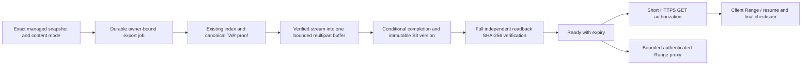

# Managed resumable download: implementation and local evidence

## Scope and baseline

Branch: `codex/managed-resumable-download`. Base: fetched `origin/main`,
`3a78cee1870fc1a23302a9f8f0ccaaf4b2a963d8`. The base already contains the merged
symlink change `c9017b809efa92a62a542a346910a862a2b3a07f` and Agent post-dump fix
`c4f25489afffb23d2091b3a5b9cced923ff5ec89`; both ancestry checks passed. Work was
performed in a separate worktree. No other feature branch was merged or cherry-picked.

This adds an opt-in temporary export service and delivery choice. Standard Download,
Full Download / Regular Files Only, Restore, classic/mobile browsing, metadata
pagination/cache limits, replication, Agent and backup scheduling retain their
existing contracts. No Agent upgrade, production access, push, merge or deployment
was performed. **Hosted CI has not been run for this unpublished branch.**

**HCP/SITP production acceptance is BLOCKED:** no authorized endpoint, credentials,
client network or production proxy logs were supplied. MinIO evidence below establishes
the local candidate only. Neither 21 GB nor 77 GB production acceptance is claimed.

## Confirmed failure modes and remaining diagnosis

The existing Standard Download produces a verified, non-seekable Restic TAR stream.
It does not retain previously emitted bytes or have a stable seekable HTTP object.
Restarting Restic and pretending its output supports arbitrary Range is unsafe.
Asynchronous preparation solves admission/preparation timeouts; it cannot make a
later multi-hour HTTP transfer resumable. Standard now explicitly advertises
`Accept-Ranges: none` and retains its streaming/proof validation.

The production disconnect's initiating cause is **unknown**. Browser tab switching
is not established as a cause. Client/network closure, intermediary timeout, source
stall, native-client failure and VM pressure need correlated origin, SFTP/storage
and proxy evidence. S3 does not automatically improve office/WAN or source throughput.

New bounded diagnostics record socket-accepted bytes, first-byte time, elapsed time,
average/five-second throughput, last-write age, HTTP backpressure time, Node RSS,
available cgroup memory/current host pressure indicators, HTTP status and a closed
termination category. Native archive events include Restic exit status/signal,
classification and active repository session count. S3 diagnostics retain counters
and at most 20 operation names/status categories, including one controlled read-reset
retry. They never copy subprocess contents, object keys, signed URLs, credentials,
environment values, file inventories or database records.

These observations have precise limits:

| Observation | Meaning / limit |
|---|---|
| `origin-stream-complete` | The origin accepted the complete verified stream; it does not prove client persistence or checksum verification. |
| `peer-closed` | The origin connection closed. A client and an intervening proxy cannot be distinguished from that socket alone. |
| Native exit / inactivity timeout | Establishes the native pipeline outcome. Restic can mask a descendant Rclone/SFTP failure; no fabricated independent Rclone exit is reported. |
| Origin HTTP status | Does not establish an upstream gateway's 429/502/503/504/524. Frontend tests exercise these HTML/error responses; inspect redacted edge logs for production attribution. |
| RSS / cgroup bytes / host load | Resource evidence, not proof that pressure caused a particular disconnect. |
| Direct S3 grant | Records authorization, not bytes received by the user's computer. |

One **local S3 protocol** issue was reproduced: this MinIO version closes/reuses a
connection around the intentional conditional-multipart 412 probe; the following
read could receive `ECONNRESET`. Diagnostics confirmed operation, zero HTTP status
and error category. A single reset retry is allowed for metadata/read commands
before a response body is handed off. UploadPart, object writes and Complete are
not replayed. The regression test checks both sides of that boundary. This is not
presented as the production download's cause.

## Architecture decision

| Option | Decision |
|---|---|
| Existing verified streaming TAR | Retained as Standard Download, with no external staging. Interrupted transfer restarts. |
| Complete server-local archive | Rejected. Tens of GB of VM disk staging and full archive buffers are not introduced. |
| Private temporary S3 export | Implemented behind explicit operator configuration and runtime security/compatibility probes. |



`RemoteRepositoryRecoveryService.withVerifiedExport` is the narrow integration
boundary. It holds an index lease, revalidates the exact backup/plan/source/repository
and full snapshot binding, and reuses the existing `ManagedTarExport` proof/stream
implementation. Explicit retries may rebuild a previously failed metadata index;
there is no automatic archive regeneration/reuse after an interrupted job.
No TAR/path/link validator was forked or relaxed.

Preparation can require a full canonical source pass; upload streams another
proof-checked pass. Completion requires successful native exit and exact proof
length/hash. A further complete S3 readback verifies the stored object independently
of its multipart ETag. This deliberately costs source reads and verification time.
Cached completed proofs can avoid repeating the preparation pass. Client resume
uses the completed object and does not invoke Restic again.

The temporary destination uses **separate environment configuration, bucket,
credentials and lifecycle**. It does not require plan replication, read encrypted
replica contents as TARs, modify replica receipts, or fall back to another repository.
Isolation conservatively rejects any registered S3 storage with the same bucket
name or access-key identifier, even across endpoint aliases. It is rechecked before
work, before readiness and before download authorization.

## Durable state, bounds and cleanup

Private metadata lives in `data/temporary-exports/jobs.sqlite`, separate from the
application schema; no application database migration is added. A second SQLite
ownership handle holds an exclusive process lock, automatically released on crash.
Directories/files use 0700/0600 on Linux. Metadata contains generated job identity,
hashed session owner, exact domain binding, destination fingerprint, generated key,
progress, proof summary and upload/version identifiers. It contains no credentials,
presigned URL or archive bytes.

| Bound | Enforced value |
|---|---:|
| Export worker | 1 |
| Active plus queued exports | 4 |
| Uncleaned object/job reservations | 4 |
| Durable metadata records | 64; only cleaned terminal records may be evicted |
| Metadata record / SQLite file | 32 KiB JSON / 2,048 default 4 KiB pages (8 MiB) |
| Multipart working buffer | One 16 MiB reusable buffer; one part request at a time |
| Maximum archive | 128 GiB; at most 8,192 parts |
| Aggregate archive reservations | 256 GiB |
| Export execution deadline | 7 days |
| Storage preflight / cleanup attempt | 60 s / 60 s (preflight's own cleanup 30 s) |
| Automatic cleanup attempts | At most 10; pending cleanup retains its reservation |
| Authenticated proxy streams / concurrent authorization checks | 2 / 2 |
| Default object availability after Ready | 72 h; operator setting bounded to 1–168 h |
| Download grant | At most 300 s, clipped to remaining object availability |
| Metadata API listing pages | At most four pages of 100 per exact generated scope |

Exact archive length is reserved after source proof validation and before multipart
archive creation. Failed/uncertain cleanup does not release the size reservation.
Small random capability probes are separately bounded and contain no user data.
An unavailable metadata store stops export work instead of creating a tight retry
loop. A fresh disabled installation does not create an export store. Failure to
open optional export metadata does not replace existing backup/restore services.

On restart, queued/running/validating/uploading/verifying jobs fail explicitly as
interrupted. Their exact uploads/owned versions are reconciled; partially uploaded
bytes are never reused. Verified Ready metadata survives restart and remains useful
without reconstructing the evicted index, subject to current domain authorization
and pinned-object checks. Native hard-restart tests cover pre-completion upload,
completed-but-unverified object, and an already verified Ready object.

Cleanup checks the two generated keys only: archive and random probe. It discovers
unpersisted uploads, aborts exact upload IDs, verifies part/upload absence, enumerates
owned object versions and handles delete markers. Ownership metadata must match
the generated job and binding before version deletion. Current and known pinned
version HEAD checks independently guard against a misleading empty listing.
Foreign keys/versions are not deleted. Deletion failure remains visible and blocks
capacity release. A confirmed missing/corrupt Ready object invalidates that job so
an explicit retry receives a new identity; temporary storage unavailability keeps
a verified object available for later authorization renewal.

The application expiry worker requires the application and storage to be reachable.
Provider outages, changed destination configuration, retention locks or permissions
can defer physical deletion; no hard deletion guarantee during such an outage is
claimed. Configure and test an independent provider lifecycle before production.
It must cover noncurrent versions, delete markers and abandoned multipart uploads.
Its timings must accommodate the seven-day active-job bound plus configured Ready
TTL; an automatic one-day multipart abort would break a legitimate multi-day export.
Preserve the old destination configuration/state until pending cleanup completes.

The existing metadata limits remain 500,000 entries, 256 MiB per index, two indexes,
and 128 MiB per proof sidecar. Capacity depends on path/metadata density as well as
entry count. An early combined fixture with a longer generated source root correctly
failed closed as `storage-full` before an archive read. The successful combined
fixture uses a shorter disposable root and still contains 115,552 long-name small
files plus real payload. No index limit or security assertion was increased/removed.

## Security and protocol contract

Runtime preflight requires HTTPS with certificate verification, an existing private
versioned bucket, verified `AES256` SSE-S3 headers, private ACL behavior, anonymous
GET denial, byte-accurate Range, old-version reads after another version is created,
version/upload enumeration and conditional multipart completion refusal. It also
exercises deletion of the random probes. Missing required capabilities fail closed
before backup contents are uploaded. The server does not provision buckets, alter
bucket policy/versioning, enable public ACLs or bypass certificate validation.

New configuration is documented in `.env.template`: `MANAGED_EXPORT_ENABLED`,
`ENDPOINT`, `REGION`, `BUCKET`, `PREFIX`, `ACCESS_KEY_ID`, `SECRET_ACCESS_KEY`, optional
`SESSION_TOKEN` / `CA_FILE`, and `TTL_SECONDS`, all with the `MANAGED_EXPORT_` prefix.
It defaults disabled. Custom CA files must be absolute regular CA certificate files,
bounded in size and not writable by other users on Linux. Destination fingerprints
exclude credentials, permitting independent credential rotation with the same scope;
endpoint/region/bucket/prefix/trust changes fail closed for older jobs.

Use dedicated least-privilege credentials for the temporary bucket/prefix. Required
operations are bucket-versioning inspection, prefix-scoped object/version/upload
listing, object/ACL/version reads, SSE writes/multipart completion, abort/part
inspection and exact version deletion. No policy write, bucket creation, repository
credential or generic storage operation is exposed through the export API.
For this MinIO release, ACL reads reuse the **read-only GetBucketPolicy permission**;
its policy action set does not accept all AWS ACL action names. The local test grants
that read and proves policy writes and writes outside the export prefix are denied.
See the [versioned MinIO ACL handler](https://github.com/minio/minio/blob/RELEASE.2025-09-07T16-13-09Z/cmd/acl-handlers.go).
Other providers require their own least-privilege interoperability review.

All endpoints require an existing administrator cookie and bind jobs to its verified
owner identity. Backup/plan/source/repository/full-snapshot/content-mode binding is
checked on each job operation. API keys/MCP bearer tokens do not authorize these
routes. Client input cannot choose an endpoint, key, snapshot, credentials, replica,
format, TTL or destination. JSON/query overrides fail closed.

| Route under `/api/backups/:id/exports` | Contract |
|---|---|
| `POST /` | Strict content mode; durable admission / deduplication; 202 |
| `GET /:exportId` | Owner-bound sanitized job progress/status |
| `DELETE /:exportId` | Cancel and request exact temporary-data cleanup |
| `POST /:exportId/authorization` | Short private GET grant for the pinned version |
| `GET /:exportId/link` | Authenticated 303 to a newly authorized direct download |
| `GET, HEAD /:exportId/content` | Bounded proxy; size, strong SHA validator, Range / If-Range / 206 / 416 |

The proxy supports one byte range, including suffix/open ranges. Unsatisfiable or
multiple ranges return 416 with `Content-Range: bytes */size`. A nonmatching If-Range
returns the complete 200 representation. Size/version/ETag/encryption/ownership are
checked before bytes. A partial-stream failure closes HTTP rather than appending
JSON to TAR. Client disconnect cancels that read, not the durable Ready export.

Direct URLs are private bearer capabilities for one generated immutable version,
with no permanent secret key sent to the browser. The signing protocol includes an
access-key identifier; the URL itself must be protected. They are issued only after
full readback verification and renewed against the same job/version. Cache/referrer
controls are private/no-store and no-referrer. Do not log signed query strings at
the application, reverse proxy or object-storage edge.

AWS describes [versioned/conditional object reads](https://docs.aws.amazon.com/AmazonS3/latest/API/API_GetObject.html),
[conditional multipart completion](https://docs.aws.amazon.com/AmazonS3/latest/API/API_CompleteMultipartUpload.html)
and [presigned URL expiry](https://docs.aws.amazon.com/AmazonS3/latest/userguide/using-presigned-url.html).
An already established AWS transfer may continue beyond URL expiry; a later request
needs valid authorization. This behavior, Range, If-Range/If-Match and signing must
be tested on the actual HCP/proxy path. Browser-native Resume is not guaranteed.

## Verified client resume workflow

1. Select delivery method **Reliable Download**, retaining the existing Full or
   explicitly partial Regular Files Only content mode. Leave the export running
   until the stored object is verified Ready.
2. Record export identity/filename, mode, exact snapshot, byte size and SHA-256.
   Choose **Get or renew resume link**. Keep that bearer link private.
3. Use a resume-capable client against that pinned object. For a private Linux
   client, keep the URL out of shell history/process arguments using a 0600 curl
   config file. A typical command is:

   ```sh
   curl --fail --proto '=https' --config /private/client/resume.conf \
     --continue-at - --output 'backup-<same-export-id>.tar'
   ```

   The private config contains `url = "<short private URL>"`; add the operator CA
   file with `--cacert` when required. Do not use `-k`. Curl must receive 206 with
   Content-Range starting at the existing local file length. The native fixture
   additionally sends the saved If-Range validator and checks the returned offset.
4. If the link expires after interruption, renew it for **the same export** and
   continue the same local file. A new export ID, mode, size or checksum means a new
   file; do not append across export generations. For the authenticated proxy,
   renew the administrator session as necessary and retain its SHA-based validator.
5. Compare the complete local archive SHA-256 to the recorded verified checksum,
   validate TAR, and extract only into an empty private unprivileged destination.
   Cloud upload completion alone does not establish client download completion.

## Local Docker acceptance

The disposable lab uses real Restic 0.19.1 and Rclone 1.75.1, actual authentication,
router/controller/service code, a separate backend OS process, read-only SFTP,
HTTPS MinIO with a generated CA and SSE key, versioned private storage, a separate
scoped export user, Node HTTP clients and real curl continuation. The application
fixture is unprivileged with 2 CPU / 4 GiB, zero swap and a read-only root filesystem;
S3 is a separate external-role container (1 CPU / 1 GiB). No ports are published.
Only invocation-owned networks/volumes are created and removed. A 32 GiB free-disk
guard precedes large fixture generation. Payloads contain real random bytes, not
sparse zero files. Source/client/extraction files belong to the disposable test
client/orchestrator; the backend does not stage a complete archive.

Pinned MinIO image digest:
`sha256:14cea493d9a34af32f524e538b8346cf79f3321eff8e708c1e2960462bd8936e`
(RELEASE.2025-09-07T16-13-09Z). Test-client digest:
`sha256:a7fe349ef4bd8521fb8497f55c6042871b2ae640607cf99d9bede5e9bdf11727`.
The test-only derivative uses the already available native fixture image; it is
not a production image or a claim that a pristine machine has that local base.

| Fixture | Source entries | Verified TAR bytes | Export to verified Ready | Real curl resume offset / remaining transfer time | Result |
|---|---:|---:|---:|---:|---|
| 120 MB, internal symlink | 4 | 120,005,632 | 11.392 s | 108,005,068 / 52 ms | PASS |
| 1.23 GB | 7 | 1,230,007,296 | 58.109 s | 123,000,729 / 1.564 s | PASS |
| 3.17 GB + long-name metadata | 115,566 | 3,406,661,632 | 212.927 s | 340,666,163 / 4.889 s | PASS |
| 4 GB | 17 | 4,000,012,288 | 186.676 s | 400,001,228 / 5.833 s | PASS |
| 80,000+ metadata entries | 80,003 | 163,846,144 | 51.366 s | 16,384,614 / 176 ms | PASS |

The small run reconstructed one file after intentional disconnects at 10%, 50%,
90%, then real curl `--continue-at -`. Every continuation checked exact 206 offset
and final size/SHA. Larger cases disconnected at 10% then resumed with curl. Each
case validated TAR, extracted unprivileged, compared historical source-time file
hashes (the live source had changed), checked original repository/source inventories
for mutation, and verified zero remaining export objects/versions/parts after expiry.

Small fault cases also passed Ready-object hard restart with no new archive read,
restart during multipart upload, restart after completion before verification,
multipart failure, duplicate requests, queued second export, cancellation,
Regular Files Only with exact symlink exclusion and independently downloaded/extracted
bytes, versioning-disabled refusal, public-destination refusal, real 750 ms SFTP
pause/recovery, expired one-second authorization and renewal, and proxy interruption /
continuation. The 2 MiB slow-client window took 3.970 s at a requested 500 KiB/s.
This is a bounded bottleneck exercise, not a complete 77 GB run at that speed.

| Fixture | Backend Node peak RSS | Restic / Rclone peak RSS | Whole fixture cgroup peak | OOM kills |
|---|---:|---:|---:|---:|
| Small | 371,326,976 | 154,165,248 / 220,196,864 | 1,272,967,168 | 0 |
| 1.23 GB | 423,268,352 | 168,734,720 / 228,839,424 | 4,295,512,064 | 0 |
| 3.17 GB / metadata | 664,973,312 | 400,539,648 / 240,328,704 | 4,296,421,376 | 0 |
| 4 GB | 423,743,488 | 171,786,240 / 246,632,448 | 4,297,011,200 | 0 |
| Metadata | 689,987,584 | 293,109,760 / 73,400,320 | 2,405,785,600 | 0 |

Cgroup accounting includes fixture generation, local repository, client/extraction
page cache and both Node roles. Large peaks were near the 4 GiB ceiling, including
small kernel accounting overshoot, with no observed OOM kill. They do not establish
comfortable headroom for a production VM's other services or a 77 GB repository.
Backend part memory remains fixed; local client/inventory memory is not described
as backend streaming memory. One Restic process was observed at a time.

A separate completed small resource/fault rerun read actual cgroup CPU and OOM
counters: 140.631252 CPU-seconds, 54.79% of the two-CPU budget across the entire
fixture, 252 throttled periods and 48.835919 throttled seconds. It recorded
`oom=0`, `oom_kill=0`, 365,457,408-byte backend Node peak RSS and
1,143,939,072-byte whole-fixture cgroup peak. These CPU figures include fixture
generation, clients, native processes, verification and all injected failures;
they are not a fabricated production CPU or isolated transfer benchmark.

The measured small pipeline spent 0.663 s streaming metadata, 3.288 s in the first
native archive/proof pass (including the injected SFTP pause), 4.120 s uploading the
proof-checked source stream, and 0.589 s in object readback verification. Its actual
server metadata footprint after Ready was 70,144 bytes, with a 36,864-byte index.
Source generation/validation and upload are coupled by backpressure; these are
effective pipeline durations, not an invented independent SFTP wire-rate measurement.

Standard comparison prepare/transfer times were 9.173 / 21.798 / 76.043 / 67.483 /
13.060 seconds for the table order. The large cases reused the completed source
proof already cached by Reliable; the small restart made its comparison cold.
They are not equivalent cold-cache before/after benchmarks. Reliable preparation
adds durable storage and readback work. The local resumed S3 reads were much faster
than complete source preparation, but local hot-cache/network results do not predict
WAN throughput. Actual production bottleneck attribution remains open.

## Validation commands and status

Local verification is recorded below; hosted Actions remain unverified. No existing
test was disabled, assertion removed or production timeout increased.

| Check | Status |
|---|---|
| Full Windows backend suite | Final isolated run: 205 suites passed; 4,191 tests passed; four existing platform/native-environment skips; 203.567 s |
| Full frontend suite | 360 passed, zero skipped; final rerun 46.725 s |
| Export lifecycle/storage/telemetry regressions | Repeated targeted checks passed; final suite includes 38 tests for the new modules, including late cancellation / authorization races |
| Linux native matrix | All five table cases passed; small fault/cleanup acceptance passed repeatedly, including final bounded-probe code |
| Linux complementary unit checks | Seven suites passed, 199 tests passed in 67.600 s; one existing Windows/root-only case skipped and covered by Windows |
| Backend/frontend types, backend lint | Passed; production build also compiles both applications |
| Production build | `pnpm build`: all three tasks passed; rerun 60.022 s (two cached tasks); final cancellation safeguards also passed backend production rebuild, lint and type check |
| Source/container-input/security scripts | 146 passed / one pre-existing baseline failure; see below |
| Pinned MySQL worker + API inventory final targeted check | 20 passed, zero skipped; readiness driver 487.845 ms |
| Hosted GitHub Actions / production HCP | NOT RUN / BLOCKED respectively |

The existing Windows skips were Linux filesystem analysis, symlink staging escape,
unsafe client ownership and the disposable native-client probe. The complementary
unprivileged Linux run passed those cases. No new platform skip was introduced.

The final cancellation checks also cover cancellation while the last asynchronous
binding check or URL signature is pending. They require the cancelled export to
remain cancelled and refuse returning a newly generated authorization. A targeted
Windows rerun including those checks and all ten pre-existing credentials scenarios
passed 48/48 in 29.485 seconds. One broader concurrent-build run hit the existing
15-second `RemotePlanCredentials` subprocess timeout (204 suites passed, one failed;
4,190 tests passed, one timed out, four existing skips). No timeout or assertion was
changed. Its targeted repeat passed, then the complete suite ran with the build/native
matrix finished and passed 205/205 suites and 4,191 tests. This observation supports
local scheduling pressure as the explanation for that isolated test run; it is
unrelated to the production download disconnect and does not establish hosted CI PASS.

The source/security command was
`node --test scripts/__tests__/*.test.cjs scripts/__tests__/*.test.mjs` (147 tests).
Its one failure is `databaseRecoveryImage.test.cjs:20`: the existing test searches
for the literal `RUN node --loader`, while `Dockerfile.source` now uses
`RUN test ...` followed by `&& node --loader`. It therefore compares the `USER pluton`
position to `-1`. Both inputs are byte-identical to `origin/main`; the Dockerfile blob
is `6f8d663b5ab2744cd1ff18a218bbd8254cb920b4`. A read-only check against the baseline
reproduced the same false assertion (`USER` index 2357; literal RUN index -1).
This unrelated guard was not disabled, weakened or silently reported as passing.
It needs a separate correction before claiming an entirely green container workflow.
Pinned Oracle worker package/import/readiness checks in this command passed.

Reproduction commands:

```text
pnpm install --frozen-lockfile
pnpm --filter @plutonhq/core-backend test --runInBand
node --experimental-strip-types --test frontend/__tests__/*.test.ts
pnpm --filter @plutonhq/core-backend lint
pnpm --filter @plutonhq/core-backend exec tsc --noEmit
pnpm --filter @plutonhq/core-frontend exec tsc -b
node scripts/api-inventory.mjs --check
docker build -f scripts/fixtures/managed-resumable/Dockerfile -t pluton-resumable-native:local .
./scripts/validate-managed-resumable.ps1 -Modes small,large,combined,four,metadata
./scripts/validate-managed-resumable-unit.ps1
pnpm build
```

The Linux runner is additive/manual and never edits Docker/WSL global settings or
production storage. Its large fixture sources are generated in private disposable
volumes. Root S3 setup belongs to the lab orchestrator; the backend child receives
only the scoped export credentials. Completed test volumes/networks/containers are
removed; the reusable local test image is retained.

## HCP interoperability and production acceptance gates

Every item remains a production gate until tested with separately authorized
disposable storage and the real client/proxy network:

- Exact HTTPS S3 API endpoint, hostname/CA trust and client reachability; exclude
  console endpoints and certificate bypasses. Confirm region/V4 signing and path style.
- Dedicated private bucket/prefix and independent least-privilege principal;
  anonymous versioned GET denial and no public policy/ACL. Confirm provider-specific
  ACL inspection permissions without granting policy writes or repository access.
- Actual SSE-S3 AES256 request/response behavior, key management and encryption at
  rest. Unsupported encryption evidence fails closed; do not infer it from marketing.
- Versioning, old-version byte identity after newer writes, HEAD/GET version and
  ETag consistency, complete-object SHA-256, multipart MD5/part limits, conditional
  completion and maximum supported object size.
- Real arbitrary/suffix/open Range, 206/Content-Range, safe If-Range/If-Match,
  416 and final checksum after multiple disconnects. Test the exposed HTTPS route.
- Presigned GET support, expiry, renewed URL to the same immutable version and
  in-progress transfer behavior. Browser Resume and sleep/network changes need
  actual browser evidence; curl evidence does not certify seamless Chrome Resume.
- No signed query logging, cache/encoding/range rewriting or referrer leakage at
  the S3 edge, WAF, reverse proxy, access logs, monitoring or support tooling.
- Exact multipart abort/part absence, object version/delete-marker deletion,
  visibility consistency, lifecycle fallback and reconciliation after hard restart.
  Object Lock/default retention must not prevent required temporary-data deletion.
- Provider byte/object/multipart quotas and billing/cleanup visibility; timestamps
  must accommodate slow active exports and configured post-Ready TTL.
- CORS only if adding browser JavaScript cross-origin object reads. Current native
  navigation/curl does not establish that future CORS capability.
- Test actual 21–77 GB historical snapshots, metadata density and coexistence with
  other VM services under 2 CPU / 4 GiB. Capture CPU, memory pressure, source/edge
  throughput and session counts. Do not increase resources/timeouts to conceal failures.
- Correlate sanitized origin and gateway 429/502/503/504/524 evidence before claiming
  a production cause. Re-test TLS/auth renewal, proxy fallbacks and repeated resume.

Enable only after these gates and owner approval. This branch performs none of
those production actions automatically.

## Symlink integration and rollback

The symlink work is already in the main baseline. This feature consumes its existing
validated stream and `ManagedExportMode` contract; Full/Regular Files Only retain
their content semantics and explicit partial warning. Shared-file edits are limited
to the narrow recovery-service bridge, Standard transfer observer, application
mount/lifecycle, existing download panel delivery choice, and a test helper returning
its Express instance. No changes to link graph/TAR validation, restore execution,
replication protocol or Agent are required.

Rollback preserves metadata and destination access until all owned uploads/versions
are cancelled/deleted and inventories verified. Existing short grants expire within
their bound, but an already open provider transfer may continue. Disable new
Reliable admissions, finish/cancel outstanding jobs and verify cleanup before
removing configuration or reverting the branch. Keep an independent provider
lifecycle and investigate any cleanup-pending reservation; do not delete the metadata
file to make the queue appear empty. Standard Download remains the original fallback.

## Changed files

The exact changed paths are:

```text
.env.template
backend/package.json
backend/src/controllers/BackupController.ts
backend/src/controllers/ManagedExportController.ts
backend/src/createApp.ts
backend/src/routes/managedExports.ts
backend/src/services/ManagedExportService.ts
backend/src/services/RemoteRepositoryRecoveryService.ts
backend/src/stores/ManagedExportStore.ts
backend/src/utils/managedExport/ExportIsolation.ts
backend/src/utils/managedExport/ExportPolicy.ts
backend/src/utils/managedExport/S3ExportStorage.ts
backend/src/utils/managedExport/TransferTelemetry.ts
backend/src/utils/restic/ManagedSftpRepositorySession.ts
backend/__tests__/integration/managedResumableRecovery.lab.ts
backend/__tests__/integration/managedResumableRecovery.process.ts
backend/__tests__/integration/managedSymlinkRecovery.runtime.ts
backend/__tests__/services/ManagedExportService.test.ts
backend/__tests__/services/RemoteRepositoryRecoveryService.test.ts
backend/__tests__/services/S3ExportStorage.test.ts
backend/__tests__/utils/TransferTelemetry.test.ts
docs/API_COVERAGE_MATRIX.md
docs/api-inventory.json
docs/MANAGED_RESUMABLE_DOWNLOAD_REPORT.md
frontend/src/components/Plan/Backups/DownloadPreparation.tsx
frontend/src/components/Plan/Backups/ReliableDownload.tsx
frontend/src/utils/reliableDownload.ts
frontend/__tests__/downloadPreparation.test.ts
frontend/__tests__/reliableDownload.test.ts
pnpm-lock.yaml
scripts/api-inventory.mjs
scripts/fixtures/managed-resumable/Dockerfile
scripts/validate-managed-resumable-unit.ps1
scripts/validate-managed-resumable.ps1
```
