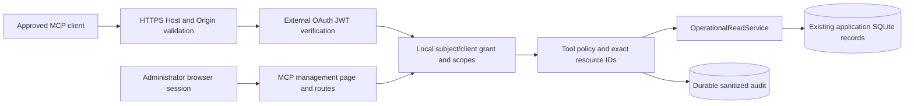

# MCP v1 OAuth reference

This document records the original v1 behavior. For current native tokens, operational actions, human approvals, proxy/client compatibility, rollout and rollback, use [MCP v2](MCP_V2.md). The v1-only statements below do not describe native v2 capabilities. External OAuth remains available and read-only. Browser HTML GET `/mcp` now reaches the administration SPA; machine GET still returns 405.

This release provides a disabled-by-default, read-only MCP integration and an administrator MCP page. It uses the official TypeScript SDK `@modelcontextprotocol/sdk` **1.32.1**, with stateless Streamable HTTP and JSON responses. It supports `2025-11-25`, `2025-06-18` and `2025-03-26` HTTP protocol revisions. The SDK negotiates initialization; a requested unsupported revision may negotiate down, and clients must accept the negotiated revision. Unsupported `MCP-Protocol-Version` headers are refused. No legacy HTTP+SSE endpoint or persistent session is implemented; authenticated GET/DELETE `/mcp` return 405.

The current published MCP specification resolved to **2026-07-28** during review on 2026-10-23. That revision is **not implemented or claimed** by the installed maintained v1 SDK. SDK v2 documentation describes a newer API/protocol; migrating to it requires a separate compatibility review and tests. Clients requiring only the newest revision cannot use this release.

## Architecture



REST and MCP share one `OperationalReadService` over the existing application database. Existing rich editor services hydrate settings/secrets or perform live probes, so this service projects only approved stored fields. It does not implement a second backup orchestrator, call internal HTTP APIs, execute Restic/Rclone, contact storage, allocate Agent commands or alter legacy/managed lifecycle behavior. MCP reads write audit/client activity locally; “read-only” refers to protected operational resources and repositories.

## Security model and configuration

Configure an **existing, reviewed OAuth 2.1 provider** with authorization code + PKCE S256, resource indicators (RFC 8707), metadata discovery, explicit user consent and registered client/redirect URIs. Pluton is the resource server; it does not implement authorization, registration, token, refresh or provider-secret storage endpoints. Those endpoints and client provisioning belong to the IdP. Automatic client registration is not assumed; pre-register clients if your provider requires it.

Place these placeholders in the existing operator-managed environment mechanism:

```dotenv
MCP_RESOURCE_URL=https://backup.example.internal/mcp
MCP_OAUTH_ISSUER=https://identity.example.internal/
MCP_OAUTH_JWKS_URL=https://identity.example.internal/oauth/jwks
```

URLs must be canonical HTTPS without credentials, query or fragment. Resource path must be exactly `/mcp`. Issuer, audience and trailing slash are exact contracts. Configure a stable IdP JWKS URL; no token-supplied `jku`, `x5u` or arbitrary issuer discovery is trusted. JWKS retrieval has a three-second timeout/cooldown. Key rotation follows the verifier's JWKS cache behavior. No TLS verification bypass is provided.

Require RFC 9068 access JWTs with `typ: at+jwt`, RS256 or ES256, exact issuer, audience containing `MCP_RESOURCE_URL`, `sub`, numeric `exp`/`iat`, signed `client_id`, and space-separated `scope`. Tokens older than one hour, with a lifetime exceeding one hour, expired or not yet valid are refused. `azp`, if supplied, must agree with `client_id`. ID tokens, local web cookies, universal API keys, model-provider keys, enrollment tokens and Agent HMAC secrets cannot authenticate MCP.

In the **MCP** page, register the exact subject and OAuth client ID, a friendly label, selected scopes and exact resource IDs. Empty resource lists grant no resources; there are no wildcards or default global grants. Optional grant expiration is independent of token expiration. Subject/client identity is immutable; permissions can be edited. One authorization per subject/client pair is supported. Revoked pairs cannot be re-enabled through an update; provision a new IdP client identity for replacement. No Pluton credential is issued/displayed during registration.

Both token scope and current local grant scope must authorize a tool. Plan IDs constrain plan/backup/replication/recovery records; Agent IDs and storage IDs use their own lists. A client cannot infer another plan's backup by ID. Resource IDs are stable identifiers, not ownership inferred from a UI name. The community edition still has one local administrator; IdP users are delegation identities, not a new tenant system.

Enable the service explicitly on the MCP page after review. Missing/invalid configuration prevents enabling and keeps the remote gateway inaccessible even if an old policy was enabled. Initial migration policy is disabled. Disabling tools blocks both discovery and execution, including corresponding v1 REST routes. Policy/grants are reloaded for every request/invocation; no persistent MCP session confers continuing authority.

Use **Revoke** with confirmation to deny the client's next authenticated request. Local revocation is immediate for subsequent requests. This JWT resource server does not introspect every token or maintain an IdP token revocation list: IdP-side token revocation may take effect only at JWT expiry (maximum one hour). Use short-lived tokens and local grant revocation for immediate Pluton denial; assess this limitation with your IdP before deployment.

## Tool and authorization matrix

All tools are read-only, require authentication, an enabled service/tool, scope intersection and exact resource IDs, and write sanitized invocation audit records. None requests human approval because none can mutate protected resources.

| Tool | Scope | Resource boundary | Returned evidence |
|---|---|---|---|
| `pluton_list_plans` | `plans:read` | `planIds` | IDs, active/in-progress, created/last backup timestamps |
| `pluton_get_plan` | `plans:read` | exact plan ID | Same bounded plan DTO |
| `pluton_list_agents` | `agents:read` | `agentIds` | ID/device ID, version, last authenticated heartbeat, revocation |
| `pluton_get_agent_status` | `agents:read` | exact Agent ID | Same Agent DTO; no invented Online status |
| `pluton_get_source_access_status` | `agents:read` | exact Agent ID | Stored report time/version, applied-request presence; freshness unevaluated, paths omitted |
| `pluton_list_backups` | `backups:read` | exact authorized plan | Stored primary outcomes, timestamps, snapshot receipts, artifact count/error presence |
| `pluton_get_backup_status` | `backups:read` | backup's plan must be granted | Same backup DTO |
| `pluton_list_storages` | `storages:read` | `storageIds` | IDs and creation time; health `not_measured` |
| `pluton_list_replications` | `replication:read` | exact authorized plan | Durable managed jobs, attempts, status, verification/error-code evidence |
| `pluton_get_replication_status` | `replication:read` | job's plan must be granted | Same managed job DTO; no paths/ownership tokens |
| `pluton_list_recovery_tests` | `recovery:read` | exact authorized plan | Test status/time/failure code, independent artifact/import validation enums |
| `pluton_get_recovery_status` | `recovery:read` | test's plan must be granted | Same recovery DTO; import disabled/not configured is distinct from passed |

Collection arguments: `limit` (default 20, maximum 50), `offset` (default 0, maximum 10000). Plan-scoped collections require `planId`. Details require `id` (1–128 letters/digits/underscore/hyphen). Unknown arguments and JSON-RPC batches are rejected. Results use `{schemaVersion:"1", observedAt, evidence:"stored_records", data}`. Collections contain `{items,limit,offset,hasMore}`. SQL limits are applied before materialization. Output schemas validate stored evidence; corrupt/unexpected fields fail closed. Complete tool results are bounded to 64 KiB, including text and structured representations; database-validation arrays to 50 entries. Stable IDs replace potentially sensitive names/configuration.

Snapshot IDs are historical receipts, not live inventory. Database artifact counts are reported metadata, not proof of a valid dump/import. Primary success does not prove mirror completion. Replica verification does not prove recovery. An Agent heartbeat does not prove Source Access was applied. Even a passed recovery test is a result at its recorded time, not a guarantee of current repository availability. No system-health, storage-probe, snapshot-file, backup-content or legacy repository tool is advertised.

## Exact REST endpoints

The twelve new machine read routes mirror the tools with the **same OAuth, scope, resource policy, tool-disable and audit enforcement**:

```text
GET /api/v1/operations/plans
GET /api/v1/operations/plans/:id
GET /api/v1/operations/agents
GET /api/v1/operations/agents/:id
GET /api/v1/operations/agents/:id/source-access
GET /api/v1/operations/plans/:planId/backups
GET /api/v1/operations/backups/:id
GET /api/v1/operations/storages
GET /api/v1/operations/plans/:planId/replications
GET /api/v1/operations/replications/:id
GET /api/v1/operations/plans/:planId/recovery-tests
GET /api/v1/operations/recovery-tests/:id
```

[OpenAPI 3.1](mcp-openapi.json) describes these reads directly from catalog input/output schemas. It does not pretend to describe all legacy APIs. Error responses are `{schemaVersion:"1",success:false,error:<stable code>,traceId}`; codes include `invalid_request`, `invalid_token`, `insufficient_scope`, `not_found`, `rate_limited`, `invalid_stored_evidence`. Unknown/unauthorized detail resources share 404. Invalid token responses include a Bearer resource-metadata challenge; REST insufficient scope includes the required scope challenge. No query-string credential authentication is accepted.

New administrator-only contracts:

```text
GET  /api/mcp-admin/overview
PUT  /api/mcp-admin/policy
GET  /api/mcp-admin/tools
GET  /api/mcp-admin/clients
POST /api/mcp-admin/clients
PUT  /api/mcp-admin/clients/:id
POST /api/mcp-admin/clients/:id/revoke
GET  /api/mcp-admin/activity
```

Management uses a signed local administrator cookie and same-origin JSON for writes, never an OAuth/API token. Grant registration body is `{name,clientType,subject,oauthClientId,scopes,planIds,agentIds,storageIds,expiresAt}`; expiration is epoch milliseconds or null. Policy body is `{enabled,disabledTools}`. Revoke body is `{}`. Collections use bounded `limit/offset`; activity accepts exact `clientId` and an allowlisted `outcome`. Create returns 201, update/revoke 200, duplicates/revoked updates 409. All management envelopes include `schemaVersion:"1"` and `success`. Creating a duplicate subject/client pair cannot mint a second authorization; revoke is idempotent.

## Clients and compatibility

Official documentation was opened and reviewed on 2026-10-23. The same backend serves all clients; there are no provider-specific server forks. No account credentials were supplied and **no live Claude, Codex or Grok account connection was tested**. The official SDK client completed a disposable Streamable HTTP integration test. This is protocol-level evidence only.

### Claude

[Claude custom remote connectors](https://support.claude.com/en/articles/11175166-get-started-with-custom-connectors-using-remote-mcp) use Settings → Connectors → Add custom connector. Enter the approved HTTPS `/mcp` URL and use the configured IdP sign-in/registered OAuth client option supported by your organization. Register the resulting signed subject/client identity in Pluton before operational access. Published identity/DCR options require matching IdP support; do not invent a dynamic-registration endpoint in Pluton. Claude's cloud must reach the endpoint; a locally reachable private URL is insufficient. No Anthropic model-provider API key is required by Pluton. Network and account availability must be verified with a real test account.

### Codex CLI and IDE

[Official Codex MCP documentation](https://developers.openai.com/codex/mcp) documents shared CLI/IDE configuration and Streamable HTTP bearer-token environment variables:

```toml
[mcp_servers.pluton]
url = "https://backup.example.internal/mcp"
bearer_token_env_var = "PLUTON_MCP_ACCESS_TOKEN"
```

Populate that environment variable privately with a valid resource-bound token from your approved IdP. Do not place token values in repository configuration, URLs or command arguments. Alternatively, configure the server URL and use `codex mcp login pluton` with the IdP's supported registered-client/PKCE flow. The IdP must support the client identity/redirect scheme selected by the installed Codex version. `codex mcp list` confirms configuration, not authorization or successful tool execution. A model-provider OpenAI API key is unrelated to this server's authentication.

### Grok / xAI

[Official xAI remote MCP documentation](https://docs.x.ai/developers/tools/remote-mcp) documents Remote MCP in its API/SDK, including `server_url`, `server_label` and `authorization`. A sanitized Responses API tool entry is:

```json
{
  "type": "mcp",
  "server_url": "https://backup.example.internal/mcp",
  "server_label": "pluton",
  "authorization": "<resource-bound MCP access token>"
}
```

Use the provider's documented token-header convention and verify it with your account. The native xAI SDK uses different names for some optional allowlist/header fields; no undocumented consumer Grok custom-connector menu/format is claimed here. xAI documents that its `require_approval`/`connector_id` fields are not supported in the Responses API. Backend authorization remains mandatory regardless of a client's tool allowlist. Pluton needs no xAI key; using the xAI inference API independently requires the user's own provider authentication.

### Generic clients

Use a standards-compliant Streamable HTTP client with `Authorization: Bearer <resource-bound token>`, `Content-Type: application/json` and `Accept: application/json, text/event-stream`. Discover the configured issuer at `/.well-known/oauth-protected-resource/mcp`, or follow the `WWW-Authenticate` resource-metadata URL after a 401. Metadata is public only when the service is enabled and transport validation passes. The resource server's metadata is distinct from the IdP's authorization-server metadata. Follow the negotiated protocol; this release does not support 2026-only request semantics.

## Activity and audit

The MCP page shows configured authorizations, expiration/revocation, never-used/authorized/recently-active states, last successful authentication, tool switches and bounded activity pages. “Recently active” means a successful authenticated request in the last 15 minutes, including non-tool protocol requests; it is not permanent Online status. Refresh obtains current backend data. Claimed Claude/Codex/Grok labels do not identify models or expose conversations.

Every accepted authenticated MCP protocol/tool request and scoped REST invocation records a trace, grant/client identifier, principal, safe operation, outcome and duration. Authorized target IDs are attached after successful resource admission; failed input/unauthorized targets and arbitrary tool names are not copied into audit. Unknown-tool attempts are recorded as a fixed denied operation. Invalid authentication has no trusted principal and is rate-limited without copying attacker tokens/claims into durable records. Policy/grant/revocation audit and state changes are transactional. No raw bodies, paths, SQL, dumps, storage configuration, secret values or exception text are saved by this feature. A started record may remain after a crash; it does not imply successful completion.

Audit has no automatic deletion/retention job in this release. It grows on disk; the page remains bounded/paginated. Operators must plan capacity and an independently approved audit-retention policy. Existing process/proxy access logging must separately redact Authorization/Cookie/query credentials; this feature does not reconfigure external infrastructure.

## Write operations and future approvals

All MCP writes and write-request scopes are unavailable. There is no pending action creation, approval, rejection, execution or replay token endpoint. The dashboard states this limitation and has no fake approval controls. Existing administrator backup/pause/validation/retry operations remain separate.

Before adding writes, a separate reviewed design must persist exact action/resource/normalized parameters, authenticated subject, registered client, expiry, idempotency key and relevant policy/state revision. A separately authorized human must approve through the browser, never the requesting client or its textual confirmation. Atomically consume approval once, bind parameters/state, recheck current authorization and existing application admission immediately before execution, durably record dispatch/outcome and handle crash recovery/replay. Parameter substitution or an invalidated revision must fail closed. No unsafe partial implementation is delivered here.

## Reverse proxy, WAF and TLS

Expose only approved paths through an explicitly reviewed reverse proxy. **This task did not publish ports, change firewall/WAF rules or deploy anything.** Keep direct backend ports private. Use trusted TLS certificates and preserve the exact configured Host. Configure `TRUST_PROXY` for actual known proxy hops/CIDRs; the MCP gateway requires `req.secure`, so an untrusted `X-Forwarded-Proto` alone cannot enable HTTP access. The edge must replace forwarded headers and block direct untrusted access. The existing Agent insecure-HTTP exception never applies to MCP.

For BunkerWeb or another WAF, route `POST /mcp`, `OPTIONS /mcp`, the protected-resource discovery GET path and optionally the explicit v1 reads. Authenticated MCP GET/DELETE return JSON 405 by design. Permit JSON-RPC POST bodies up to 16 KiB, Bearer headers, `MCP-Protocol-Version`, and both Accept content types. The current stateless JSON mode needs no long-lived SSE buffering exception, event reconnect route or sticky session. Future SSE support would require its own buffering/timeouts review. Apply narrow path-specific adjustments if legitimate MCP JSON is blocked; never disable WAF protections globally.

The gateway permits only the configured web origin when an Origin header exists; non-browser clients may omit Origin. Cookie headers are refused. Preflight permits exact origin/method/header values without returning operational data. Denied/malformed requests have sanitized JSON responses. IP limit: 120 requests/minute before verification; grant limit: 60/minute. These in-memory limits are per process and reset on restart; use an edge limiter if running multiple replicas. Management also has an authenticated 120/minute limiter plus the existing application limit. JSON body limit: 16 KiB. JWKS timeout: 3 seconds. Tool transport deadline: 10 seconds. SQL reads are bounded and local, but synchronous SQLite work is not preemptible by a JavaScript timer.

Provider cloud clients may require network reachability from their published egress ranges. Review current official ranges, TLS trust, IdP discovery and redirect allowlists; no provider ranges are hardcoded in this repository. An internal endpoint requires an explicitly reviewed connectivity design; do not tunnel or expose it automatically.

## Standalone Agent distribution

Keep `.env` as the authoritative source for `AGENT_INSTALL_REPOSITORY_URL`, `AGENT_INSTALL_COMMIT`, `AGENT_INSTALL_VERSION` and optional CA file. Compose already passes these through. A database override/UI would create conflicting authority without an established configuration-management/audit/rollback layer, so none is introduced.

`agentDistribution` validates the URL shape, full lowercase nonzero 40-character SHA and supported standalone version `0.7.0` before `AgentService.createEnrollment` generates/persists a token. Missing configuration returns actionable 503 without enrollment side effects. It validates configuration syntax locally, not the remote repository's existence or the commit's contents. The generated standalone install workflow verifies the checkout SHA, clean working tree and declared version before installation. Moving branches do not change a pinned SHA. Existing installed Agents are unaffected by changing a future installation pin; this is not an updater.

For an operator-approved release change: review standalone public source/license and expected version, independently verify the exact immutable commit and installation artifacts in disposable staging, record approver/date/repository/SHA/version in the operator's private change record, retain the prior approved tuple, then update the authoritative deployment environment during an approved change. Roll back by restoring the previous exact tuple. Do not use branch names, auto-follow new commits, include credentials in Git URLs, or generate enrollment merely to check configuration. No production restart/update was performed in this task.

## Troubleshooting and limits

| Symptom | Check |
|---|---|
| 404 `mcp_disabled` | Configuration valid, migration applied, service enabled by administrator; do not substitute the public health URL. |
| 403 `invalid_transport` | HTTPS at trusted proxy, exact Host/Origin, no Cookie, no MCP query string; no insecure Agent exception. |
| 401 `invalid_token` | Correct IdP access JWT profile/issuer/audience/sub/client, token/authorization expiry, local revocation, accessible trusted JWKS. |
| Missing tool / insufficient scope | Token AND local scopes, tool exposure switch, current service policy; client-side tool lists do not grant access. |
| 404 `not_found` | Exact resource ID is granted and exists; a hidden resource looks identical to a missing one. |
| `invalid_stored_evidence` | Stored fields fail explicit DTO validation; inspect privately as administrator, never broaden output or return raw data as fallback. |
| HTML or redirect instead of JSON | Inspect status, Content-Type, WAF/reverse-proxy request ID; application errors are JSON. Never treat HTML 200 or login redirects as MCP success. |
| No pending approval actions | Expected: write requests are unavailable. |
| No live health/source paths or snapshot contents | Expected read-MVP privacy/operation boundary. |
| SDK works but provider does not | Check provider protocol/auth profile, registered OAuth identity/redirect and provider network reachability with an approved staging account. Generic SDK success is not provider connectivity proof. |

Production remains unverified. HTTPS termination, IdP PKCE/resource issuance/key rotation/revocation, actual Claude/Codex/Grok login, BunkerWeb behavior, cloud firewall access and target-device visual/accessibility review require approved staging tests. No claim of full latest-protocol or production readiness is made.

## Verification and migration

Migration `0020_mcp_authorizations` adds policy (disabled), authorization and audit tables/index only. It does not rewrite plans, backup records or retention settings. Back up application state through the approved operator process before any eventual deployment. Apply normal application migrations; leave MCP disabled until reviewed. OAuth environment is operator configuration; client permissions/tool exposure live in these SQLite tables with no competing `.env` override. New dependencies are pinned; use pnpm 10.20.0 and the lockfile.

Run from repository root:

```text
pnpm --filter @plutonhq/core-backend test:mcp
pnpm --filter @plutonhq/core-backend test --runInBand
node --experimental-strip-types --test frontend/__tests__/mcp.test.ts
node --test scripts/__tests__/apiInventory.test.mjs
node scripts/api-inventory.mjs --check
pnpm --filter @plutonhq/core-backend exec tsx scripts/mcp-openapi.ts --check
pnpm --filter @plutonhq/core-backend exec tsc --noEmit -p tsconfig.json
pnpm --filter @plutonhq/core-frontend exec tsc -b
pnpm --filter @plutonhq/core-backend lint
pnpm --filter @plutonhq/core-frontend lint
pnpm build
```

MCP integration tests use Node/tsx because the SDK/Jose dependencies are ESM; existing backend Jest tests remain unchanged. All new integration fixtures use migrated in-memory SQLite and synthetic keys; the official client uses a local disposable HTTP adapter with explicit proxy headers. No real backup application is started or real storage accessed.

Primary references: [MCP authorization](https://modelcontextprotocol.io/specification/2026-07-28/basic/authorization), [current Streamable HTTP](https://modelcontextprotocol.io/specification/2026-07-28/basic/transports/streamable-http), [official TypeScript SDK](https://github.com/modelcontextprotocol/typescript-sdk), [v2 protocol migration](https://ts.sdk.modelcontextprotocol.io/v2/migration/support-2026-07-28.html). Client references appear in their connection sections above.
