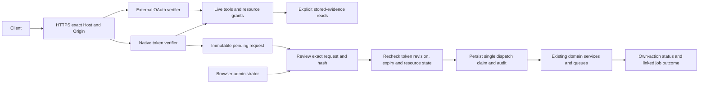

# MCP v2 operator and developer runbook

MCP lets an assistant use explicitly granted Pluton tools. Native Pluton tokens work without an external identity provider; existing external OAuth remains separate and read-only. Neither provides a model subscription or provider API key. The gateway defaults disabled. No real backup, restore, Agent or deployment was used to validate this change.

## Architecture and authentication



Browser cookies authorize administration only. Native tokens authorize only exact tools/resources. Agent credentials and the old universal API key cannot authorize MCP. Native prefixes never enter the OAuth verifier, and JWTs never enter the native verifier. Native-only deployments publish no fake OAuth discovery, registration or token endpoints. Both modes may coexist; metadata then describes the actual external IdP only.

OAuth retains RFC 9068 `typ: at+jwt`, RS256/ES256, exact issuer/resource audience, signed subject/client identity, exp/iat, max one-hour age/lifetime, static JWKS and scope intersection. See the [v1 OAuth reference](MCP.md) for IdP requirements. Local grant revocation is immediate; IdP-side JWT revocation may take effect only at expiry. OAuth cannot acquire write authority by asserting `mcp:write`.

The official SDK remains pinned to **1.32.1**, supporting **2025-11-25, 2025-06-18 and 2025-03-26** stateless Streamable HTTP with JSON responses. Unsupported headers fail closed; initialization negotiates a supported revision. No legacy SSE or persistent session is supplied. The [current transport specification](https://modelcontextprotocol.io/specification/latest/basic/transports) resolved to 2026-07-28 during review on 2026-10-24; that revision is not claimed by this SDK integration.

## Native setup and UI

Use the existing operator-managed environment, with placeholders only in Git:

```dotenv
MCP_RESOURCE_URL=https://backup.example.internal/mcp
MCP_NATIVE_TOKENS_ENABLED=true
```

The flag defaults false. Resource URL must be canonical HTTPS, no credentials/query/fragment, path exactly `/mcp`. An incomplete OAuth issuer/JWKS pair makes configuration invalid even when native mode is requested. Optional OAuth uses `MCP_OAUTH_ISSUER` and `MCP_OAUTH_JWKS_URL`. Compose forwards these variables; the feature does not restart services or modify live configuration.

1. Review TLS/proxy prerequisites in a disposable staging deployment.
2. Log in as the local administrator, open **MCP**, then explicitly enable the service.
3. Under **API Tokens**, choose **Create API token**. Enter a name, optional purpose and Read Only / Write Only / Read and Write.
4. Choose exact tools and resource allowlists. Empty lists grant nothing; wildcards are rejected. Remote operational writes require the selected plan, its Agent and its storage; local writes require plan and storage.
5. Select TTL 1–2160 hours (90 days); default 168 hours. All operational writes always require human approval. No bypass policy is exposed.
6. Copy the credential into a secret manager before closing. No list/edit screen can retrieve it. Rotation revokes the old credential immediately. The UI issues a seven-day replacement; the API accepts bounded TTL.
7. The copy-once dialog's **Test connection** sends only MCP initialize, omits cookies and refuses redirects. Success verifies this browser's authentication/initialization, not a provider connection, Agent readiness or backup completion.

The UI includes token permissions/resource selectors, status/issuer/expiry/last-use, disable/revoke/rotate, pending/history pagination, exact request/hash and before/after previews, authenticated approve/reject/reconcile, tool policy, audit filters and client guidance. **Disable service** blocks machine access and approval dispatch independently of ordinary backups. **Emergency revoke all native tokens** changes no Agent/OAuth/browser credential. Revocation never cancels already dispatched work.

Plans with enabled replication also require grants for every configured replica storage; those storage configurations and private plan-credential/repository bindings contribute to approval state hashes. They are never returned to the assistant.

Tokens have a nonsecret CSPRNG 96-bit ID and separate 256-bit secret, namespaced `pluton_mcp_`. SQLite stores only SHA-256 of the complete credential, justified by secret entropy, with constant-time digest comparison and a dummy verifier for unknown IDs. This does not claim constant database or end-to-end timing. Plaintext appears only on creation/rotation, lives in mounted dialog memory, and is excluded from browser storage and persisted query/mutation caches. Clipboard contents remain the operator's responsibility. Metadata contains issuer, timestamps, grants and revision. Permission/state changes increment revision and invalidate pending approvals, even after disable/re-enable. Editing permissions never extends expiry.

## Permission matrix

Safe reads require enabled service/tool, current authorization and exact resource IDs. Native reads require `mcp:read` plus exact tool selection. OAuth reads require the listed scope in both token and grant. Stored-evidence reads do not probe storage, contact Agents, execute Restic or read files. Names, paths, raw errors and credentials are omitted.

| Preserved read tool | OAuth scope | Resource boundary |
| --- | --- | --- |
| `pluton_list_plans` | `plans:read` | Selected plans |
| `pluton_get_plan` | `plans:read` | Exact plan |
| `pluton_list_agents` | `agents:read` | Selected Agents |
| `pluton_get_agent_status` | `agents:read` | Exact Agent |
| `pluton_get_source_access_status` | `agents:read` | Exact Agent; stored report, paths omitted |
| `pluton_list_backups` | `backups:read` | Exact plan; snapshot receipts are recovery candidates |
| `pluton_get_backup_status` | `backups:read` | Backup belongs to selected plan |
| `pluton_list_storages` | `storages:read` | Selected storage; health not measured |
| `pluton_list_replications` | `replication:read` | Exact plan |
| `pluton_get_replication_status` | `replication:read` | Job belongs to selected plan |
| `pluton_list_recovery_tests` | `recovery:read` | Exact plan |
| `pluton_get_recovery_status` | `recovery:read` | Test belongs to selected plan |

Every new request tool requires native `mcp:write`, its exact tool grant and the associated plan/storage/remote Agent grants, plus **human approval**. Write-only discovers no operational read tools; its own minimal status is the sole read exception.

| New tool | Additional boundary | Approved domain effect |
| --- | --- | --- |
| `pluton_request_backup_now` | Active idle plan | Existing manual backup, no hooks/retention/capacity overrides |
| `pluton_request_pause_plan` | Active plan | Existing pause/schedule disable |
| `pluton_request_resume_plan` | Paused plan | Existing resume/schedule enable |
| `pluton_request_cancel_backup` | In-progress backup belongs to plan | Existing cancellation mechanics |
| `pluton_request_create_plan` | Authorized remote filesystem template; no enabled hooks/replication/database lifecycle | Clone approved source/settings to server-generated destination; runNow false |
| `pluton_request_update_plan` | Idle plan | Title only |
| `pluton_request_update_schedule` | Idle plan; explicit valid IANA timezone | Strict interval replacement, preserve other settings, show preview |
| `pluton_request_update_exclusions` | Idle remote plan | Bounded relative exclusions; preserve source includes; risk warning |
| `pluton_request_recovery_test` | Successful completed backup and remote plan | Existing isolated recovery policy/dedicated targets only |
| `pluton_get_action_status` | Native write mode; own token's action only | Minimal request/dispatch and correlated job outcome |

Risk classification is safe-read or operational; destructive/privileged actions are unavailable. Request annotations: readOnly false, destructive false (no destructive data operation), idempotent true **with required stable key**, openWorld false. Read/status annotations use readOnly true. No approval can authorize a tool that does not exist.

Common request fields: exact `planId` and `idempotencyKey` (16–80 letters/digits/underscore/hyphen). Use one stable key per intent and reuse it for retries. Cancel/recovery add backupId; create/update add title; schedule adds strict interval including timezone; exclusions adds at most100 patterns. Unknown fields, `approved:true`, client source/destination paths and delegated-root changes are rejected. Exclusion parsing reuses the existing contract and rejects whole-tree wildcard patterns; human review remains necessary for broad patterns.

Creation deliberately uses an existing approved template rather than arbitrary source paths. It excludes enabled hooks, replication and database lifecycle; use the existing UI for those configurations. Destination uses the template location plus action UUID. Normal PlanService schema, Source Access and storage validation still apply. Schedule enable/disable uses pause/resume. Limited plan edits cannot change credentials, source roots, retention, scripts or database settings.

Reads retain runtime-validated versioned DTOs, collection limit1–50/default20, offset0–10000 and complete64KiB envelope bounds. Snapshot receipts are not a live snapshot catalog. Primary success does not prove replication or recovery success. Recovery import disabled/not configured differs from passed. Linked own-action progress exposes bounded phase/terminal/success only; backup correlation is recorded only when exactly one new durable job is observed. Otherwise progress/result ID is unavailable and domain history must be inspected. Dispatched never means completed.

## Approval and restart safety

Prevalidation creates an immutable pending record for 15minutes or token expiry, whichever comes first. It binds token ID/revision, action, plan/backup, canonical sorted-JSON argument hash, resource-state hash, expiry and idempotency key. State includes plan settings/source, selected job, active backups/restores, Agent identity/capabilities, Source Access report/selection, storage and recovery policy/targets. Secret-bearing configuration contributes only to an internal hash, never a preview. Routine Source Access receipt timestamps are excluded.

The human administrator sends the displayed hash via the same-origin browser-session API. MCP has no approval route/tool. Approval rechecks token grants/revision, service/tool policy, TTL, resource state and conflicts. A changed request/resource requires a new request. At most one pending/executing/uncertain action per plan, ten per token and100 globally are allowed.

SQLite commits the execution claim/audit before domain-service entry. Duplicate approval or network retry cannot replay it. Services retain their normal queues, MAX_CONCURRENT_BACKUPS, distributed capacity and admission. This is not a distributed transaction or global lock with Agent/storage/scheduler/other UI workflows: concurrent changes during async service work can cause safe rejection or uncertainty. The approved payload itself cannot change.

States: pending_approval → executing → dispatched, or rejected/expired. Exceptions after possible side effects become **uncertain**. Startup marks interrupted executing rows uncertain and never retries them. Pending rows survive if valid. Inspect domain history, resolve live work, then explicitly reconcile to close without replay. Request/decision/dispatch/expiry audits correlate via action ID. Dispatch audit records acceptance/failure, not fabricated job completion; real domain history and projected linked-job status provide completion evidence.

Status/history polling records the linked job's first terminal observation once in the audit. This observation time is not its actual finish time; domain history remains authoritative. No separate MCP completion worker is added. Schedule updates pass only the requested interval to PlanService, which preserves unrelated lifecycle settings and credentials through its existing merge logic.

## HTTP routing, Cloudflare and BunkerWeb

Machine POST `/mcp`: HTTPS, exact configured Host, no cookies or query string. Present Origin must equal resource origin. SDK Content-Type/Accept and supported protocol headers apply. Browser GET `/mcp` with HTML Accept and no Authorization reaches the normal SPA; authenticated machine GET/DELETE returns405. Do not rewrite machine POST to HTML/login or legacy SSE.

Forward Authorization, Host, Accept, Content-Type, MCP-Protocol-Version and JSON body unchanged. Preserve external HTTPS and block direct public backend access. Configure `TRUST_PROXY` for reviewed last-hop peers only; never trust all senders. Disable caching for machine/admin routes and preserve no-store. Do not log Authorization or token-issuance response bodies. Do not disable the WAF globally: review narrowly scoped method/body rules or machine challenge handling for exact endpoints while retaining auth/TLS/rate limits. No wildcard privileged CORS and no query tokens. This feature does not change proxy accounts/settings.

Limits:120requests/minute/IP before verification,60/minute/principal,120/minute administrator. Entropy and uniform digest comparison supplement rate limits; they do not replace them.

| Error | Check |
| --- | --- |
| 401 | Bearer header, native flag, expiry/revocation; OAuth audience/profile/client grant; never substitute browser/Agent/provider credentials |
| 403 | TLS/Host/Origin/cookie contract, tool/resource grants, admin same-origin JSON; MCP may return sanitized JSON-RPC denial instead |
| 404 | Disabled/unconfigured service; intentional absent OAuth discovery in native-only mode; inaccessible detail ID |
| 405 | Use Streamable HTTP POST, not machine GET/DELETE or legacy SSE |
| 406/415 | Preserve Accept application/json and text/event-stream, JSON Content-Type |
| 400/JSON-RPC | Supported protocol header, strict schema, bounded JSON, no batches/unknown tools |
| 409 | Pending conflict, expired/decided action or changed resource/token; refresh history |
| 429 | IP/token/admin or pending-action limit; never invent fresh retry keys |
| HTML response | WAF challenge, redirect or wrong SPA route; fix exact proxy contract |

## Client compatibility evidence, 2026-10-24

**No live provider account connection is claimed.** Accounts/credentials were not supplied. Official SDK tests exercise OAuth/native initialization, discovery, reads, requests, separate browser-admin approval, own status and revocation over the local HTTP/proxy contract. DOM tests exercise copy-once dismissal and exact approval payload. These do not prove provider reachability or real operational execution.

| Client | Documented mode and primary evidence | Remaining validation |
| --- | --- | --- |
| Claude custom remote connector | Fixed Authorization Request headers, [Anthropic guide](https://support.claude.com/en/articles/11175166-get-started-with-custom-connectors-using-remote-mcp) | Actual account/workspace/plan controls, UI availability, endpoint egress |
| Codex CLI/IDE | HTTP URL and environment-backed token, [official guide](https://learn.chatgpt.com/docs/extend/mcp) | Actual installed client/account connection |
| ChatGPT custom connector | Supported OAuth flow, [OpenAI authentication guide](https://developers.openai.com/plugins/build/auth) | Plan/workspace/UI availability; manually supplied native bearer entry is unverified and not promised |
| OpenAI Responses API | Remote MCP authorization field, [OpenAI guide](https://developers.openai.com/api/docs/guides/tools-connectors-mcp) | Provider API credentials, account and network test |

Codex config stores only an environment variable name:

```toml
[mcp_servers.pluton]
url = "https://backup.example.internal/mcp"
bearer_token_env_var = "PLUTON_MCP_ACCESS_TOKEN"
```

Load the variable from a secret manager before starting the client, outside committed config/shell history. Claude: Settings → Connectors → Add custom connector → endpoint → Request headers (where available): `Authorization` with `Bearer <PLUTON_MCP_TOKEN>`. The synthetic internal example hostname is not publicly reachable.

OpenAI Responses MCP tool (the application supplies the secret in memory on each call):

```json
{"type":"mcp","server_label":"pluton","server_url":"https://backup.example.internal/mcp","authorization":"<PLUTON_MCP_TOKEN>","require_approval":"always"}
```

Provider approval is an additional control; it never replaces Pluton's separate human approval. Provider API keys stay in the client application, not Pluton. ChatGPT uses real external OAuth and registered subject/client read grants; never weaken authentication to connect it.

## Schema, APIs and audit

Additive migration **0021_mcp_native_tokens_actions.sql**, registered after0020, creates verifier/metadata token records and immutable action records, unique token/idempotency keys, a history index and per-plan active-action uniqueness. Payload-changing updates are blocked by a SQLite trigger. Migrations are tested on disposable databases, including upgrade/preservation/re-run; no live data is read.

New administrator APIs under `/api/mcp-admin`: GET/POST tokens; PUT tokens/:id; POST tokens/:id/revoke, tokens/:id/state, tokens/:id/rotate, tokens/revoke-all; GET resources (kind plans/agents/storages), GET actions (pending filter); POST actions/:id/approve, reject, reconcile. Existing overview/policy/tools/clients/activity remain. All require the existing browser administrator and same-origin JSON on mutations. See [generated API inventory](API_COVERAGE_MATRIX.md) and [read OpenAPI](mcp-openapi.json); writes have no generic REST proxy.

Audit contains principal, token/grant reference, operation, action/resource ID, safe outcome, timestamp, duration and trace ID. Arguments exist only in immutable admin action records. Raw token/Authorization/domain errors/storage credentials are excluded. Token/policy/decision changes and audit are transactional; audit failure blocks new dispatch. A precommitted claim prevents replay even if final persistence fails. No automatic audit deletion/history purge is added; monitor disk/database growth.

## Staging rollout, incidents and rollback

1. Back up full application data/config using existing operator procedures. Test the additive migration on a disposable copy. Keep current persistent mounts unchanged.
2. Build/test pinned dependencies and configure external TLS/proxy. Leave flag/service disabled until review.
3. Issue a short-lived narrow read token; verify provider initialize/list/read/revoke from an approved staging account.
4. Grant one write tool against a disposable plan. Request, inspect exact payload, approve, and inspect the real terminal job. Verify reject/expiry/change/retry behavior. Use only approved disposable Agent/storage/recovery targets.

For a leak, immediately revoke the native token, inspect action/audit/domain history, reject pending requests and inspect already dispatched work. Rotate only after fixing the exposure. For broad incidents disable MCP and revoke all native tokens, revoke OAuth grants separately if needed, and fix client/proxy logging. Do not paste leaked credentials into tickets/screenshots. Revocation does not reverse actions.

Rollback: disable MCP, revoke tokens, reconcile executing/uncertain operations, then return the disposable/staging server to the reviewed v1 image under operator control. **Keep additive tables/history and migration journal.** V1 does not execute their actions. Never drop journal entries or restore an old whole database over newer backup/Agent state. Re-upgrade must not replay dispatched actions. Physical schema downgrade is not automated and requires a separately reviewed offline data migration.

Readiness: **isolated staging validation**, not production acceptance. Outstanding gates: live provider accounts/plan UI, external TLS/proxy/WAF/egress, Linux/Docker image behavior, approved disposable Agent/storage/recovery jobs and operational monitoring/reconciliation. Mocked domain tests prove dispatch boundaries, not real backup throughput or deployed restore safety. No production restart, push, merge or deployment is authorized by this implementation.
